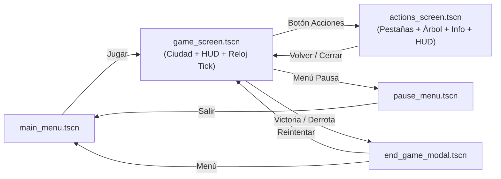
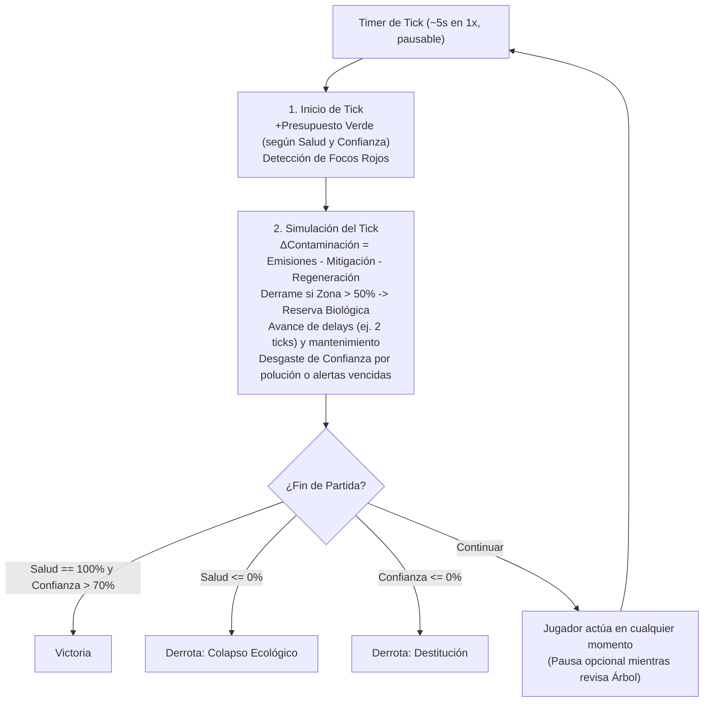

# Plan de Desarrollo: Econtainment

## Objetivo y Contexto

Este documento define el plan de desarrollo técnico y de producción para **Econtainment**, un videojuego educativo de estrategia y gestión de crisis ambientales desarrollado en **Godot 4.7** (`GL Compatibility`), dirigido a dispositivos móviles (**Android**) y **WebGL** responsivo.

El plan unifica los requisitos de:
- `docs/MiniGDD.md`: Visión, métricas, sistema de 3 zonas, árbol de 3 ramas (9 nodos) y balance.
- `docs/Diseño de Pantallas.md`: Estructura de Menú, Pantalla de Juego (Ciudad arriba + GUI abajo) y Pantalla de Acciones (árbol dinámico scrolleable a la izquierda + detalle a la derecha).
- `docs/Lista de Assets.md`: Bucle por Ticks, desglose de elementos visuales por zona en 3 estados y estética por rama.

---

## Decisiones de Diseño Confirmadas

1. **Modelo de Tiempo:** **Tiempo real por Ticks** (1 Tick = ~5 segundos = 1 mes simulado), con controles de **Pausa** y **Velocidad (1x / 2x)**. Las duraciones del GDD ("1 turno de anticipación", "tarda 2 turnos en activarse", "atender en el mismo turno") se mapean directamente a **Ticks**.
2. **Terminología Social:** Se utilizará **Confianza Ciudadana** (0%–100%) en toda la interfaz y código.
3. **Orientación y Resolución Base:** **Horizontal / Landscape (`1280×720`)** con `window/stretch/mode="canvas_items"` y `aspect="expand"`.
4. **Árbol de Acciones:** Pantalla con **pestañas por rama** (*Concientización*, *Legislaciones*, *Acciones Directas*) y generación automática del árbol scrolleable en 2D a partir de datos (`ActionData`).
5. **Estrategia Visual:** Construcción del **MVP jugable con placeholders geométricos** (Fases 1–4) para validar lógica y balance antes de integrar el arte 2D final (Fase 5).

---

## Convenciones de Desarrollo (`AGENTS.md`)

- **Archivos y Carpetas:** `snake_case`
- **Nodos y Clases:** `PascalCase`
- **Variables y funciones:** `snake_case`
- **Constantes y Enums:** `UPPER_SNAKE_CASE`
- **Código en Inglés, Comentarios en Español**
- **Estructura:** Composición sobre herencia, `@export` fuertemente tipado en lugar de `get_node`, comunicar hacia abajo con funciones y hacia arriba con señales, filosofía KISS.

---

## Arquitectura Técnica Propuesta (Godot 4.7 / GDScript)

### Estructura de Carpetas en `res://`

```text
res://
├── assets/
│   ├── sprites/          # Zonas (normal/contaminado/sustentable), íconos, UI
│   ├── fonts/
│   └── audio/            # (Opcional post-MVP)
├── resources/
│   └── actions/          # Archivos .tres de ActionData (9 acciones del MVP)
├── scenes/
│   ├── main_menu/        # main_menu.tscn
│   ├── game/             # game_screen.tscn, city_view.tscn, zone_node.tscn, alert_badge.tscn
│   ├── actions/          # actions_screen.tscn, action_tree_canvas.tscn, action_node_button.tscn
│   └── ui/               # hud.tscn, end_game_modal.tscn, pause_menu.tscn
└── scripts/
    ├── autoload/         # game_manager.gd, event_bus.gd
    ├── data/             # action_data.gd (Resource), zone_data.gd, game_balance.gd
    ├── simulation/       # simulation_engine.gd (lógica pura desacoplada de la UI)
    └── tests/            # Scripts de verificación headless
```

### Flujo de Pantallas y Bucle Central (Ticks)





---

## Componentes Principales

### 1. Configuración Base del Proyecto (`project.godot`)
- Configurar `display/window/size/viewport_width=1280` y `viewport_height=720` (Landscape), manteniendo `stretch/mode="canvas_items"` y `stretch/aspect="expand"`.
- Registrar Autoloads `EventBus` (`event_bus.gd`) y `GameManager` (`game_manager.gd`).
- Establecer `run/main_scene="res://scenes/main_menu/main_menu.tscn"`.

### 2. Modelo de Datos y Motor de Simulación (`scripts/data/` y `scripts/simulation/`)

#### `action_data.gd` (`class_name ActionData extends Resource`)
Define cada nodo del árbol de gestión de forma declarativa:
- `id: StringName`, `branch: BranchType` (`AWARENESS`, `LEGISLATION`, `DIRECT_ACTION`)
- `title: String`, `description: String`, `pros_text: String`, `cons_text: String`
- `prerequisites: Array[StringName]` (para construir el árbol automáticamente desde la raíz abajo)
- `cost_budget: int`, `maintenance_per_tick: int`
- `delay_ticks: int` (ej. *Fomento y Economía Circular* tarda 2 ticks en activarse)
- `immediate_trust_delta: float` (ej. *Régimen Punitivo y Clausuras*: `-15.0`)
- `zone_modifiers: Dictionary` (emisiones, mitigación, regeneración por zona)
- `special_flags: Array[StringName]` (ej. `early_alert`, `vulnerable_to_spill`, `requires_budget_gt_zero`)

#### `simulation_engine.gd` (`class_name SimulationEngine`)
Lógica pura desacoplada de la UI:
- **Zonas:** `PRODUCTIVE`, `URBAN`, `RESERVE` (cada una con `pollution: float` 0–100, `emission_rate`, `mitigation_rate`, `regen_rate`).
- **Salud Ambiental global:** Calculada a partir de la limpieza ecológica de las zonas.
- **Presupuesto Verde:** Se asigna al inicio de cada tick en función de la Confianza Ciudadana y Salud Ambiental (con penalización temporal si *Consumo Crítico y Boicot* está activo).
- **Derrame Crítico:** Si `PRODUCTIVE` o `URBAN` superan el `50%` de contaminación, el excedente drena a `RESERVE`. Si hay un derrame severo y *Remediación Biológica* está activa/madurando, el humedal se destruye y debe reconstruirse.
- **Ecuación de cambio por tick:**
  $$\Delta \text{Contaminación}_z = \text{Emisiones}_z - \text{Mitigación}_z - \text{RegeneraciónActiva}_z$$
- **Alertas (Focos Rojos):** Generación de alertas por zona, anticipación de 1 tick si *Vigilancia Digital Vecinal* está activa, y penalización doble de Confianza si no se atiende antes de que expire el tick.

### 3. Escenas y UI (`scenes/`)
- `main_menu.tscn`: `MarginContainer` en los 4 lados, título grande anclado arriba a la izquierda, botones **Jugar** y **Salir** debajo.
- `game_screen.tscn`: Zona superior con las 3 zonas (placeholders en Fase 4, sprites en Fase 5), Focos Rojos clicables e indicador de derrames; barra superior derecha con Menú y controles de tiempo (**Pausa**, **1x**, **2x** + progreso del tick); zona inferior (`HBoxContainer`) con botón **Acciones** a la izquierda y `VBoxContainer` a la derecha con barras de **Salud Ambiental**, **Confianza Ciudadana** y **Presupuesto Verde**.
- `actions_screen.tscn`: Mantiene el HUD inferior, reemplaza la zona superior por selector de rama (3 pestañas), árbol scrolleable 2D generado desde datos a la izquierda y panel de detalle + botón *Activar* a la derecha.
- `end_game_modal.tscn`: Modal de Victoria / Derrota A (Colapso Ecológico) / Derrota B (Destitución), con resumen de ticks y botones *Reintentar* / *Menú Principal*.

---

## Plan de Producción por Hitos (6 Fases)

| Fase | Entregable Principal | Detalle Técnico |
| :--- | :--- | :--- |
| **1. Base y Balance** | `project.godot` + `game_balance.gd` + Autoloads | Resolución `1280×720`, `EventBus`, `GameManager` (reloj de ticks), escena inicial mínima y tabla inicial de balanceo. |
| **2. Lógica Core** | `simulation_engine.gd` + Tests | Variables de estado, bucle por ticks, $\Delta$ contaminación, cálculo de derrames (>50% a Reserva) y triggers de Victoria/Derrota. |
| **3. Árbol de Acciones** | `action_data.gd` + 9 `.tres` | Implementación de las 3 ramas, prerrequisitos, costes, mantenimiento (*Planta Gris*), delays (*Fomento Circular*) y riesgos (*Clausuras*, *Boicot*, *Humedal*). |
| **4. UI Funcional (Placeholders)** | `main_menu`, `game_screen`, `actions_screen`, `end_game_modal` | Layouts responsivos en Landscape, generación automática del árbol por pestañas, controles de Pausa/Velocidad y HUD conectado por señales. |
| **5. Alertas y Arte 2D** | Focos Rojos + Sprites en 3 estados | Reemplazo de placeholders por arte 2D (Normal / Contaminado / Sustentable), animaciones de derrame y temática visual por rama. |
| **6. Pruebas y Exportación** | Build Android (APK) / WebGL | Ajuste de dificultad para partidas de 3–5 min, validación UX sin manuales y verificación en dispositivos objetivo. |

---

## Plan de Verificación

### Pruebas Automatizadas (Godot Headless)
Script de pruebas sin interfaz (`godot --headless -s res://scripts/tests/test_simulation.gd`) para validar:
1. Cálculo de $\Delta \text{Contaminación}$ (reducción neta cuando `mitigación + regeneración > emisiones`).
2. Transferencia de excedente por derrame (>50% en Productiva o Urbana) hacia la Reserva Biológica y destrucción del humedal en derrame severo.
3. Disparo exacto de Victoria (`Salud == 100%` y `Confianza > 70%`) y ambas Derrotas (`Salud <= 0%` o `Confianza <= 0%`).
4. Prerrequisitos, deducción de presupuesto, delays y penalizaciones de las 9 acciones.

### Verificación Manual
1. Flujo completo `main_menu` -> `game_screen` -> `actions_screen` (3 pestañas) -> `end_game_modal`.
2. Controles de Pausa y Velocidad (1x / 2x) durante la partida.
3. Responsividad en `1280×720` y exportaciones Android / WebGL.
